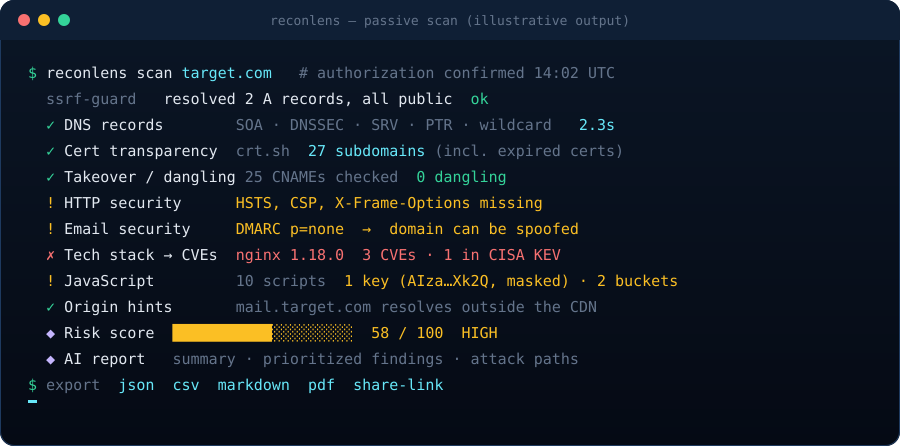
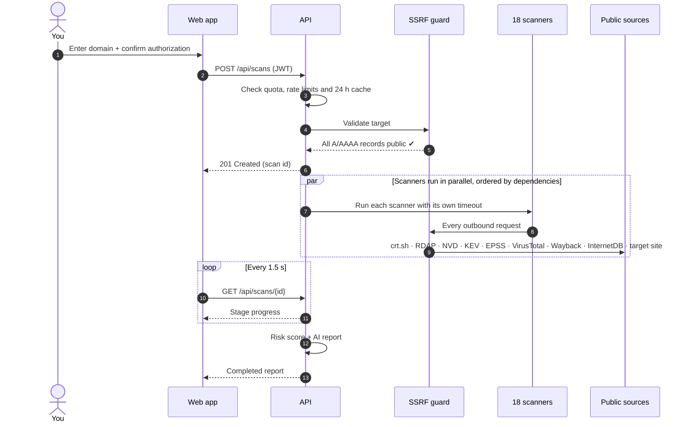
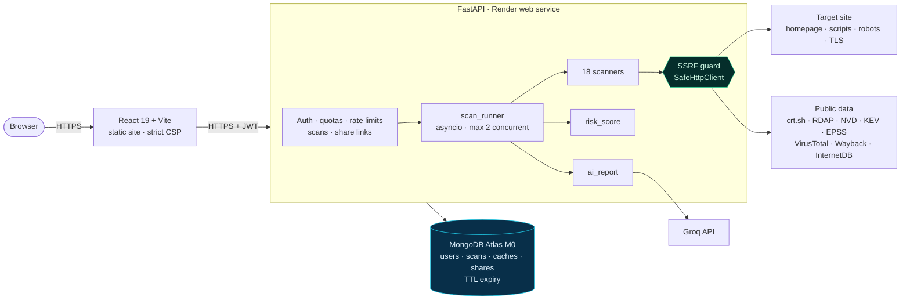

<div align="center">



<br>

[](https://reconlens.munisaidivtih.in)
[](https://github.com/munisaidivith19-sketch/ReconLens/actions/workflows/ci.yml)
[](LICENSE)


**[Live demo](https://reconlens.munisaidivtih.in)** ·
**[Checks](#-what-it-checks)** ·
**[How a scan works](#%EF%B8%8F-how-a-scan-works)** ·
**[Security design](#%EF%B8%8F-security-design)** ·
**[Run it locally](#-run-it-locally)** ·
**[Deploy](#%EF%B8%8F-deploy-to-render)** ·
**[Responsible use](#%EF%B8%8F-responsible-use)**

</div>

---

Enter a domain you're authorized to test. ReconLens maps its public attack surface, matches exposed software versions to known and **actively exploited** vulnerabilities, scores the risk from 0 to 100, and writes a prioritized analyst report. Every stage finishes live on screen, and the result exports as JSON, CSV, Markdown or PDF.

> [!IMPORTANT]
> **ReconLens is passive only.** It never sends exploit payloads, brute-forces, port-scans, fuzzes parameters or requests the endpoints it discovers. It fetches only what a normal browser visit or a public data source would provide, and every outbound request passes through an SSRF guard.

<div align="center">

<br><sub>Illustrative run. The web app shows the same stages finishing live.</sub>
</div>

## ✨ At a glance

<table>
<tr>
<td width="33%" valign="top">

### 🔭 Discover
Subdomains from certificate transparency, 20 DNS record types, takeover-prone CNAMEs, servers outside the CDN, favicon pivots, open ports already indexed by Shodan, lookalike domains, archived URLs and API routes in JavaScript.

</td>
<td width="33%" valign="top">

### 🎯 Prioritise
CVEs for detected **versions** and vulnerable JavaScript libraries, flagged when CISA lists them as exploited and scored by FIRST EPSS. A 0–100 risk score, the top 10 risk factors, the three issues to fix first and the quick wins.

</td>
<td width="33%" valign="top">

### 📝 Report
An AI analyst report with attack paths, CWE and OWASP Top 10 labels, copy-ready bug reports, comparison with the previous scan, and read-only share links that expire.

</td>
</tr>
</table>

## 🔍 What it checks

Expand a group to see each check, where its data comes from, and what you learn.

<details open>
<summary><b>🌐 Asset discovery</b>: DNS, subdomains, takeover, origin servers</summary>
<br>

| Check | Source | What you learn |
|---|---|---|
| **DNS records** | Public DNS | A/AAAA/CNAME/MX/NS/TXT/CAA/SOA/DS/DNSKEY/HTTPS/SVCB/TLSA/SSHFP/NAPTR/URI/LOC/CERT, 28 well-known SRV services, reverse DNS, wildcard and DNSSEC state, mail provider, and SaaS tools revealed by TXT verification tokens |
| **Subdomains** | crt.sh certificate transparency | Every name on a certificate, including ones that only appear on expired certificates, with the interesting ones flagged (dev, staging, admin…) |
| **Subdomain takeover** | Public DNS | CNAMEs whose target no longer exists (NXDOMAIN), matched against 32 cloud services where the name can be claimed |
| **CDN bypass / origin hints** | DNS answers already collected | Subdomains that resolve outside the CDN or WAF in front of the main site, and a shared-hosting map |
| **Favicon fingerprint** | The site's favicon (one request) | Shodan's favicon hash, with ready-made Shodan, FOFA and ZoomEye searches to find related hosts and origin servers |
| **Exposed services** | Shodan InternetDB | Open ports, software and CVEs that Shodan's own scans saw on the domain's IPs. ReconLens never scans ports. |
| **Registration** | RDAP | Registrar, creation and expiry dates, transfer lock |

</details>

<details>
<summary><b>🔐 Web, TLS & email</b>: headers, cookies, certificates, spoofing, lookalikes</summary>
<br>

| Check | Source | What you learn |
|---|---|---|
| **TLS** | One handshake to port 443 | Trust chain, hostname match, expiry, key and signature strength, legacy TLS 1.0/1.1 |
| **HTTP security** | One homepage GET | Security headers (HSTS, CSP, framing, nosniff, Referrer and Permissions policies), cookie flags, HTTPS redirect, WAF/CDN |
| **Email security** | Public DNS | SPF, DMARC and common DKIM selectors, with a plain-language verdict on whether the domain can be spoofed in phishing emails |
| **security.txt** | `/.well-known/security.txt` | Disclosure contact, policy, expiry, and hints of a bug bounty programme (RFC 9116) |
| **Mail transport security** | Public DNS + MTA-STS policy file | MTA-STS (mode and policy), TLS-RPT and BIMI, so mail can't be silently downgraded to plaintext |
| **Lookalike domains** | Public DNS | Registered typosquats of the domain (other TLDs, look-alike characters, keyboard typos, phishing words), flagging the ones with mail servers. DNS only; never visited |
| **Reputation** | VirusTotal v3 | Engine detections, categories, reputation score |

</details>

<details>
<summary><b>🧬 Vulnerability intelligence</b>: tech stack → CVE → KEV → EPSS</summary>
<br>

| Check | Source | What you learn |
|---|---|---|
| **Tech stack** | Homepage response + webappanalyzer fingerprints | Technologies and the versions they expose |
| **CVEs** | NVD API 2.0 | CVEs for detected **versions** only, never guessed from a product name |
| **Actively exploited** | CISA KEV | Which of those CVEs attackers are exploiting in the wild |
| **Exploit probability** | FIRST EPSS | How likely each CVE is to be exploited in the next 30 days |
| **Vulnerable JS libraries** | Retire.js data + script URLs and contents | Outdated jQuery, Bootstrap, Angular, Swiper and 70+ other libraries with known CVEs, and the version that fixes them |

</details>

<details>
<summary><b>🕵️ Client-side code & leaks</b>: JavaScript, archived URLs, crawler files</summary>
<br>

| Check | Source | What you learn |
|---|---|---|
| **JavaScript analysis** | Homepage + up to 10 same-site scripts it loads | Third-party files loaded without Subresource Integrity; hard-coded secrets (AWS, Stripe, GitHub, Slack, SendGrid, private keys, JWTs…), masked before they are stored; cloud buckets (S3, Azure, GCS, Firebase, Spaces, R2); API routes; in-scope hosts; source maps |
| **Endpoints** | Homepage forms + Wayback Machine CDX | Form actions and methods, archived paths, sensitive files (`.env`, `.git`, backups), and GET parameters grouped by likely bug class: redirect, file, IDOR, injection, XSS, command, debug, auth |
| **robots.txt / sitemap** | The site itself | Disallowed paths worth reviewing, sitemap size |

Everything discovered here is **listed, never requested**.

</details>

### On top of the checks

| | Feature | |
|:-:|---|---|
| 📊 | **Risk score (0–100)** | Weighted by severity, with extra weight for spoofable email, expired TLS or domain, missing HSTS/CSP, no HTTPS, likely takeovers, malicious reputation and KEV-listed CVEs. A saturating curve stops many small issues from outweighing a few serious ones. |
| 🤖 | **AI analyst report** | Groq writes an executive summary, prioritized findings, likely attack paths and next steps, using only the facts from the scan. Any CVE ID it mentions must appear in the scan data. If Groq is unavailable, a deterministic template report is used. |
| ⚡ | **Summary & quick wins** | Severity counts, attack-surface size, the three issues to fix first, and the fixes that only need a configuration change. |
| 🏷️ | **CWE + OWASP Top 10** | Every finding is labelled, the findings are searchable (try `CWE-319` or `A05`), and **Copy as report** produces a Markdown bug report ready to paste. |
| 🔁 | **Changes since last scan** | Score change, new and fixed issues, and new subdomains compared with your previous scan of the same domain. |
| 🔗 | **Share links** | Read-only links to a report. They expire after 7 days and can be revoked at any time. |
| 📤 | **Exports** | JSON, CSV (protected against formula injection), Markdown and print-ready PDF. |

## ⚙️ How a scan works



A scanner that fails or times out never stops the scan. Its stage is marked as failed with a reason, and the rest of the report is unaffected.

## 🏗️ Architecture



## 🛡️ Security design

A tool that fetches attacker-chosen URLs is itself an SSRF target, so the guard is the core of the design.

<details>
<summary><b>SSRF guard</b>: <code>backend/app/core/ssrf_guard.py</code></summary>
<br>

- It normalizes the target: IDN to punycode, and it rejects raw IPs, numeric IP tricks, credentials in URLs, other schemes and ports other than 80/443.
- It resolves **all** A/AAAA records and blocks the target if any of them is private, loopback, link-local, reserved or otherwise non-public.
- It connects to the validated IP directly, with the correct Host header and SNI, so DNS rebinding can't redirect a request.
- It follows redirects manually and re-validates every hop.
- It caps response sizes, ignores proxy environment variables and drops cookies.
- Third-party APIs go through the same client. The only exception is the Groq SDK, which only talks to Groq's fixed API host.

</details>

<details>
<summary><b>Authentication & sessions</b></summary>
<br>

- Passwords are hashed with Argon2 (pwdlib).
- Tokens are short-lived HS256 JWTs with a pinned algorithm and required issuer, audience and expiry claims.
- Error messages are generic, and login timing is equalized so it doesn't reveal whether an account exists.
- Guest sessions use a separate token type that can't reach account-only features such as history or share links.
- Share tokens are 192-bit random values. Expiry is checked on every request, and a TTL index deletes expired links.

</details>

<details>
<summary><b>Abuse controls</b></summary>
<br>

- Visitors get 3 scans without an account. Registered users get 10 a day.
- Per-IP limits apply to login, registration, guest sessions and new scans.
- At most 2 scans run at once.
- Repeat scans of a domain within 24 h reuse the cached results.
- Scope confirmation and its timestamp are stored on every scan, including cached copies.
- Detected secrets are masked before they are stored, so the full value never reaches the database.

</details>

<details>
<summary><b>API & frontend hardening</b></summary>
<br>

- CORS is an exact-origin allowlist.
- Security headers are set on every response, and the Server header is removed.
- Request bodies are limited to 16 KB.
- OpenAPI/docs are disabled.
- All errors share one JSON shape and never include stack traces.
- The frontend has a strict Content-Security-Policy with no inline scripts.
- Tokens are kept out of cookies and expire automatically.

</details>

## 🧰 Tech stack

| Layer | Technology |
|---|---|
| **Backend** | Python 3.13 · FastAPI · Pydantic v2 · PyMongo async · httpx · dnspython · cryptography · PyJWT · pwdlib[argon2] · groq |
| **Frontend** | React 19 · Vite · TypeScript · Tailwind CSS v4 · React Router · TanStack Query · recharts · lucide-react |
| **Quality** | uv · ruff · pytest · pytest-asyncio · respx · oxlint · GitHub Actions CI. Tests never touch the network. |
| **Hosting** | Render free tier (web service + static site) · MongoDB Atlas M0 · GitHub Actions keep-alive |

The design uses glass panels with dark and light themes. It respects reduced-motion and reduced-transparency settings and includes a print stylesheet.

## 🚀 Run it locally

**You need:** Python 3.13 with [uv](https://docs.astral.sh/uv/), Node.js 22+, and MongoDB (local or an Atlas connection string).

```bash
git clone https://github.com/munisaidivith19-sketch/ReconLens.git
cd ReconLens
python run.py        # installs what's missing, starts both servers, opens http://localhost:5173
```

<details>
<summary><b>Manual setup</b></summary>
<br>

```bash
# Backend
cd backend
cp .env.example .env            # then set JWT_SECRET (and optional API keys)
python -c "import secrets; print(secrets.token_urlsafe(48))"   # paste as JWT_SECRET
uv sync
uv run uvicorn app.main:app --reload       # http://localhost:8000/api/health

# Frontend (new terminal)
cd frontend
cp .env.example .env
npm ci
npm run dev                                 # http://localhost:5173
```

</details>

<details>
<summary><b>Tests & linting</b></summary>
<br>

```bash
cd backend  && uv run pytest && uv run ruff check . && uv run ruff format --check .
cd frontend && npm run build && npm run lint
```

DNS is patched and HTTP is mocked with respx, so the test suite runs offline.

</details>

<details>
<summary><b>Environment variables</b></summary>
<br>

**Backend** (`backend/.env`)

| Variable | Required | Default | Notes |
|---|---|---|---|
| `MONGODB_URI` | yes | `mongodb://localhost:27017` | Atlas: `mongodb+srv://…` |
| `MONGODB_DB` | no | `reconlens` | |
| `JWT_SECRET` | **yes** | none | At least 32 random characters |
| `JWT_EXPIRE_MINUTES` | no | `60` | |
| `GROQ_API_KEY` | recommended | none | Without it, a template report is used |
| `GROQ_MODEL` | no | `openai/gpt-oss-120b` | Any Groq model with JSON mode |
| `VT_API_KEY` | recommended | none | Without it, the reputation check is skipped |
| `NVD_API_KEY` | recommended | none | Without it, NVD's much lower anonymous rate limit applies |
| `FRONTEND_ORIGIN` | **yes** in prod | `http://localhost:5173` | Exact origin(s), comma-separated |
| `DAILY_SCAN_LIMIT` | no | `10` | New scans per user per UTC day |
| `GUEST_SCAN_LIMIT` | no | `3` | Scans a visitor can run without an account (per IP, counted over 30 days) |
| `MAX_CONCURRENT_SCANS` | no | `2` | |
| `TRUSTED_PROXY_HOPS` | no | `1` | Proxies that append to `X-Forwarded-For` (Render: 1; local: 0) |
| `LOG_LEVEL` | no | `INFO` | |

**Frontend** (`frontend/.env`)

| Variable | Notes |
|---|---|
| `VITE_API_URL` | The backend base URL, with no trailing slash. It is fixed at build time. |

</details>

## ☁️ Deploy to Render

`render.yaml` is a Render Blueprint that defines both services.

<details>
<summary><b>Step-by-step</b></summary>
<br>

1. **Create the database.** In MongoDB Atlas, create a free **M0** cluster and a database user. Under *Network Access*, allow `0.0.0.0/0`, because Render's free tier has no static outbound IPs. Copy the `mongodb+srv://` connection string.
2. **Get API keys:** [Groq](https://console.groq.com/keys), [VirusTotal](https://www.virustotal.com/gui/my-apikey) (free account) and [NVD](https://nvd.nist.gov/developers/request-an-api-key).
3. **Create the Blueprint.** In Render, go to **New → Blueprint** and select this repository. Render reads `render.yaml`.
4. **Fill in the secrets** marked `sync: false`: `MONGODB_URI`, `GROQ_API_KEY`, `VT_API_KEY`, `NVD_API_KEY` and `FRONTEND_ORIGIN`. `JWT_SECRET` is generated automatically.
5. **Match the URLs.** If Render assigns different service URLs, update `VITE_API_URL`, the CSP `connect-src` in `render.yaml` and `FRONTEND_ORIGIN`, then redeploy the static site. For a custom domain, add it to `FRONTEND_ORIGIN` too.
6. **Verify.** `https://<api>/api/health` should return `{"status":"ok","database":"ok"}`. Then register and scan a domain you own.

`frontend/vercel.json` is included if you prefer to host the frontend on Vercel.

</details>

> [!NOTE]
> **Free-tier behaviour.** The API sleeps after 15 minutes idle, and the first request after that takes about 30–60 s while the UI shows a wake-up notice. The `keep-alive` workflow pings both services every 14 minutes, pausing 03:00–03:30 IST. Scans running during a restart are marked `interrupted`. Old data expires through TTL indexes: scans after 30 days, caches after 24 hours, share links after 7 days.

## ⚖️ Responsible use

> [!WARNING]
> Only scan domains **you own or are explicitly authorized to test**, such as targets in scope for a bug bounty programme or covered by written permission. You confirm this before every scan, and the confirmation is stored with its timestamp.

- Even passive reconnaissance can breach a programme's rules. Read its policy first.
- Treat the results as leads, not proof. CVE matches rely on advertised versions, which may be backported or wrong. Verify every finding manually and within scope before you report it.
- Report vulnerabilities in ReconLens itself privately through [GitHub security advisories](https://github.com/munisaidivith19-sketch/ReconLens/security/advisories/new).

ReconLens deliberately does **not** do active scanning: no port scans, directory brute-forcing, parameter fuzzing, payloads or exploit verification. It doesn't scan IP addresses, internal ranges, non-standard ports, or hosts that resolve to non-public addresses. The in-app **Responsible use** page (`/terms`) has the full policy.

## 📚 Attributions & licences

<details>
<summary><b>Data sources</b></summary>
<br>

| Source | Use | Terms |
|---|---|---|
| [crt.sh](https://crt.sh) (Sectigo) | Certificate transparency search | Free public service; be gentle |
| [RDAP](https://about.rdap.org) / rdap.org bootstrap | Registration data | Public registry data (IANA bootstrap) |
| [NIST NVD](https://nvd.nist.gov) | CVE data | *This product uses the NVD API but is not endorsed or certified by the NVD.* |
| [CISA KEV](https://www.cisa.gov/known-exploited-vulnerabilities-catalog) | Actively exploited CVEs | Public domain (U.S. Government work) |
| [FIRST EPSS](https://www.first.org/epss) | Exploit prediction scores | Free use with attribution to FIRST |
| [VirusTotal](https://www.virustotal.com) | Domain reputation | Public API terms; free tier is non-commercial |
| [Internet Archive Wayback Machine](https://web.archive.org) | Archived URLs (CDX API) | Internet Archive terms of use |
| [Shodan InternetDB](https://internetdb.shodan.io) | Open ports, CPEs and CVEs per IP | Free, no key; non-commercial use |
| [enthec/webappanalyzer](https://github.com/enthec/webappanalyzer) | Technology fingerprints (`backend/app/data/fingerprints`) | **GPL-3.0**: see the `LICENSE` and `NOTICE.md` in that directory |
| [Retire.js](https://github.com/RetireJS/retire.js) | Vulnerable JavaScript library data (`backend/app/data/retirejs`) | **Apache-2.0**: see the `LICENSE.md` and `NOTICE.md` in that directory |
| [can-i-take-over-xyz](https://github.com/EdOverflow/can-i-take-over-xyz) | Reference links for takeover-prone services | Linked, not copied |
| [Groq](https://groq.com) | AI report generation | Groq API terms |

</details>

ReconLens's own code is MIT-licensed (see [`LICENSE`](LICENSE)). The bundled fingerprint data stays under GPL-3.0.

## 🗺️ Roadmap

- [x] Passive recon: DNS, CT subdomains, TLS, headers, email, tech stack, CVE + KEV + EPSS
- [x] Subdomain takeover, origin hints, Shodan InternetDB, security.txt
- [x] JavaScript secrets, buckets and endpoints; parameter classification
- [x] Scan comparison, share links, CWE/OWASP labels, CSV/Markdown export
- [x] Vulnerable JS libraries, SRI, favicon hash, lookalike domains, MTA-STS / TLS-RPT / BIMI
- [ ] **Local active mode:** self-hosted only, never on the public demo. Nmap service detection and Nuclei templates, gated behind explicit scope files.
- [ ] Scheduled re-scans and webhook alerts (needs a background worker, so not on the free tier)

<div align="center">
<br>
<sub>Built for defenders and authorized researchers. Recon responsibly.</sub>
</div>
